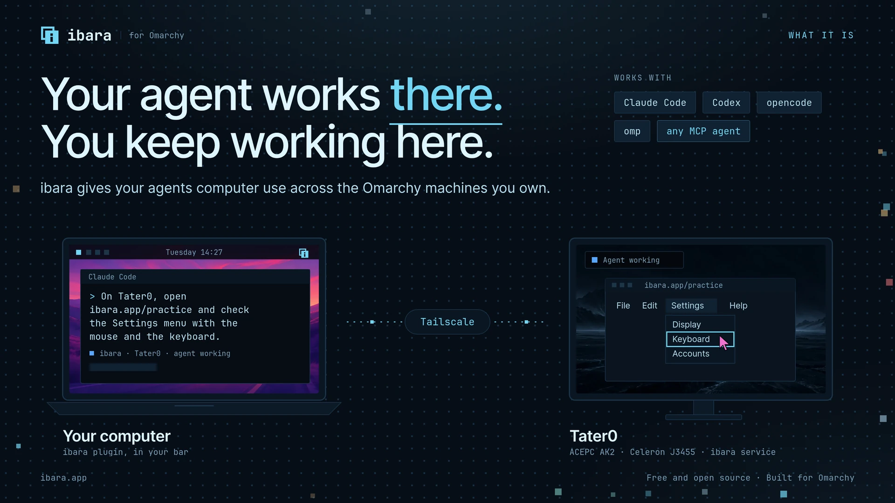
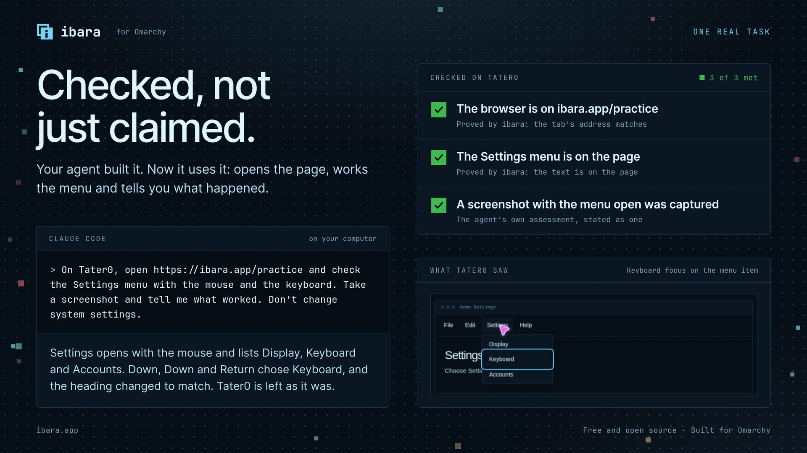

# ibara

Computer use for agents on Omarchy.

Give your agent a spare computer while you keep working on yours. It can use the spare’s desktop, browser and apps.

ibara runs in Omarchy’s bar. Its console shows your connected computers, their screens and their tasks. You can send files, collect results and take control.

[Website](https://ibara.app) · [User guide](https://ibara.app/docs) · [Release notes](https://github.com/MayberryDT/ibara/releases) · [Roadmap](https://ibara.app/docs/roadmap)

[](https://github.com/MayberryDT/ibara/actions/workflows/ci.yml)
[](LICENSE)



ibara is free and open source. It works on Omarchy computers and Omarchy virtual machines. Your computers connect through your own Tailscale network.

## Before you start

For the setup below, you need:

- 2 computers running [Omarchy](https://omarchy.org) on x86_64 hardware, with its Hyprland desktop and bar
- a [Tailscale](https://tailscale.com) account, signed in on both computers
- your own account with sudo access on each computer
- an agent that supports Model Context Protocol (MCP), such as Codex or Claude Code
- Google Chrome or Chromium on the spare for browser tasks

Either computer can be a virtual machine. The spare does not need a connected mouse or monitor. ibara creates a virtual screen when needed.

Only Omarchy is supported. No other platform is planned. The Ubuntu packages from 0.3.0 and 0.3.1 are historical and no longer receive updates.

The 3 Omarchy packages for release 0.3.1-1 total about 52.3 MB to download, excluding additional dependencies. The installer installs dependencies for you.

## Install and connect your computers

1. Run this command on each computer, as your own user rather than root.

   ```bash
   curl -fsSL https://github.com/MayberryDT/ibara/releases/latest/download/install | sh
   ```

2. Follow the setup prompts. Setup asks for your password and adds the ibara icon to your bar.
3. On your everyday computer, right-click the ibara icon to open the console.
4. Choose Add Computer, then select the spare.

The installer downloads the latest release. It checks the release signature and package checksums before installing `ibara`, `ibara-stream` and `ibara-view`.

Your own computers can pair in one step when they use the same Tailscale login and neither computer is tagged. Other pairings need confirmation.

The [pairing guide](docs/security-and-access.md#how-a-computer-is-added) explains those cases. You can also [verify a release before installing it](docs/release-verification.md).

## Connect your agent

1. In the console, choose Connect an Agent, then Copy Prompt.
2. Paste the prompt into your agent and let it complete the setup.
3. Restart the agent if it needs to reload its tools. Ask it to list your ibara computers.

You can also print the connection prompt from a terminal:

```bash
ibara prompt
```

The prompt tells your agent to add the ibara MCP server, link its skill and add instructions for future sessions.

We have tested Codex, Claude Code, opencode and omp. Other agents need MCP support. The [agent connection reference](docs/agent-tools.md#connecting) explains manual setup.

## Run your first task

Replace `spare-mini` with your spare’s name, then paste this into your agent:

```text
On spare-mini, open https://ibara.app/practice.
Check the Settings menu with the mouse and keyboard.
Take a screenshot with the menu open.
Tell me which checks passed or failed.
Do not change system settings.
Finish the task and release the computer when you are done.
```

The practice page needs no sign-in. Watch the spare in the console, then check the screenshot against the report.

The result should include:

- a pass or fail for each check
- a screenshot showing the open menu
- confirmation that the task ended and the computer was released

The [first-task guide](https://ibara.app/docs/first-task) explains how to collect files and check your own app next.



## Use ibara for your work

Give your agent a specific task and ask for evidence. For example, ask it to:

- check a web app with the mouse and keyboard, then report failures with screenshots
- edit a document, save it, reopen it and check the saved contents
- collect information from a page and return a report or file

A local development server must be reachable from the spare. Use a staging URL or your computer’s Tailscale address, rather than `localhost`.

The spare has its own browser session. Signing in on your everyday computer does not sign you in there. Follow the agent’s sign-in request or take control to sign in yourself.

Need help with setup? [Paid setup and support](https://ibara.app/support) is optional. The software remains free.

## Watch and take control

Open a computer in the console to watch its screen, follow tasks and read its history. Drop files onto its card to send them.

Choose Take Control to use its keyboard and mouse through the viewer. This pauses agents while you use the computer.

Choose Hand Back when you finish. Closing the viewer alone does not hand control back. Ask your agent to continue if its task ended.

You can manage each computer’s permissions in the Access tab. You can also share a computer through an invite that expires or that you revoke.

The [access and control guide](docs/security-and-access.md) explains permissions, invitations and taking a computer back from an agent.

## Privacy and access limits

Pictures, files and commands pass between your computers over Tailscale’s encrypted network. You do not need an ibara account.

Your agent may send screenshots, text and file contents to its model provider. What leaves your computers depends on the agent and model you use.

ibara checks for signed releases when you install or update it. Release 0.3.1 includes an optional uploader for diagnostic records. It stays off unless you enable it.

By default, recognized sending, spending, deleting and access changes need approval. You can change approval settings for your own agents.

Approvals cannot cover every action. ibara cannot always tell what a command or click will do. Agents are not confined to an isolated environment.

Give access only to agents you trust with that computer. Read the [approval limits](docs/security-and-access.md#where-the-protection-ends) before using sensitive accounts or files.

## Releases and test results

Release 0.3.1-1 improves desktop input, browser discovery, cleanup and console recovery. It includes reading pages inside iframes and shadow roots.

The release passed package checks and focused desktop tests. Its longer test campaign did not achieve 2 consecutive clean runs per operating system.

Recorded failures include Writer focus problems, partial typing, workbook errors and incomplete checks after reopening files. See the [0.3.1-1 release notes](https://github.com/MayberryDT/ibara/releases/tag/v0.3.1-1) for scope and limitations.

The September 2026 benchmark passed 132 of 157 runs on 0.1.0-17. That is a historical result, not a success rate for today’s release.

The [September results](docs/benchmarks-2026-09.md) retain every published table, including failures. The [benchmark archive](https://ibara.app/docs/benchmarks/runs) lists other campaigns and their methods.

The [roadmap](https://ibara.app/docs/roadmap) describes planned work. Source changes on this repository’s main branch may not be in the latest package.

## Update or remove ibara

Use these commands on the computer you want to change:

| Task | Command |
|---|---|
| Show the installed version | `ibara --version` |
| Check for an update | `ibara update --check` |
| Install the latest signed release | `ibara update` |
| Restore the previous release, if available | `ibara rollback` |
| Remove ibara but keep its identity and history | `ibara uninstall` |

To remove identity, pairings, history and viewer settings too, use `ibara uninstall --delete-data`. Files you received remain in `~/Downloads/Ibara`.

The separate `cua-driver-bin` package stays installed because other software may use it. Remove each agent’s ibara server, skill link and instruction block separately.

See the [removal details](docs/troubleshooting.md#starting-over) before deleting data.

## Get help and read the technical guides

If something fails, start with [troubleshooting](docs/troubleshooting.md). If you still need help, [report a problem](https://github.com/MayberryDT/ibara/issues/new/choose).

Use these guides for more detail:

- [architecture](docs/architecture.md) explains the services, network connections and stored data
- [agent tools](docs/agent-tools.md) describes the MCP tools and their results
- [compositor settings](docs/compositors.md) explains optional Hypoland input and its reduced safeguards
- [development](docs/development.md) explains building and checking the source
- [internals](docs/internals.md) describes the implementation
- [security reporting](SECURITY.md) explains how to report a vulnerability privately

## Credits and licenses

ibara’s [core](LICENSE) and [Omarchy console plugin](https://github.com/MayberryDT/omarchy-ibara) use the MIT license. The console has its own repository for Omarchy’s plugin marketplace.

[Cua](https://github.com/trycua/cua) provides the desktop driver and Hyprland plugin. Release 0.3.1 bundles Cua 0.34.1. The [vendored plugin changes](vendor/cua-hyprland-plugin/IBARA.md) retain their MIT license and notices.

Take Control uses separate GPL-3.0 programs:

- `ibara-stream` is a [Sunshine](https://github.com/LizardByte/Sunshine) fork that accepts a viewer through a single-use ticket
- `ibara-view` is a [Moonlight](https://github.com/moonlight-stream/moonlight-qt) fork with keyboard handover, file drop and its own viewer identity

The [fork details](docs/architecture.md#stream-and-viewer-forks) explain how these programs differ from their upstream projects. The forks are included in the release source archive. The [release downloads](https://github.com/MayberryDT/ibara/releases) include their source, dependencies and changes alongside the core and console source.

ibara also depends on [Omarchy](https://omarchy.org), [Hyprland](https://hyprland.org) and [Tailscale](https://tailscale.com).

## Report bugs and suggest changes

Bug reports and suggestions are welcome. Tyler maintains ibara and does not merge outside contributions directly.

You can submit a pull request to demonstrate a proposed fix. Tyler uses Claude or Codex to review submissions and decides which changes to make independently.

Read the [contribution policy](CONTRIBUTING.md) before spending time on a patch.
