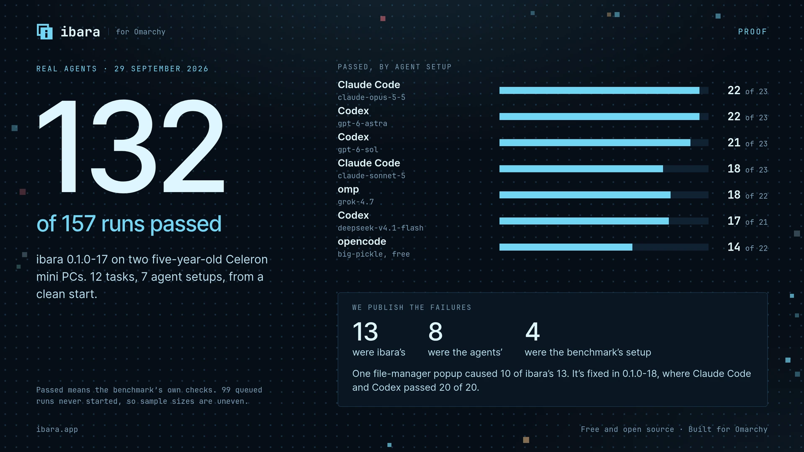

# September 2026 benchmark results

These are historical results from 27 to 29 September 2026. They describe the builds named below, not the current release.

The tables retain the measurements and limitations previously published in the README. No tests were rerun for this documentation change.

Use the [benchmark archive](https://ibara.app/docs/benchmarks/runs) to find other runs. Check each run’s build, method and limitations before comparing results.

The hardware description below applies to this campaign. Statements about untested behavior describe what had been tested at that time.

We measure ibara on 2 test computers: five-year-old ACEPC mini PCs with Intel Celeron J3455 processors, run from a console on one of them. Each result has its build and date, and the target we set where we set one. The misses stay in. The full tables are in the [benchmarks](https://ibara.app/docs/benchmarks) and the [test results](https://ibara.app/docs/tests).

## Agent tasks on 29 September 2026

Build: 0.1.0-17. Seven agent setups ran the same 12 tasks from a clean start. Each agent had only ibara's MCP server, its skill and its note in the agent's instructions, and the project's own source was hidden from it. Passed means the benchmark's own checks passed.

| Agent and model | Passed |
|---|---|
| Claude Code, claude-opus-5-5 | 22 of 23 |
| Codex, gpt-6-astra | 22 of 23 |
| Codex, gpt-6-sol | 21 of 23 |
| Claude Code, claude-sonnet-5 | 18 of 23 |
| omp, grok-4.7 | 18 of 22 |
| Codex, deepseek-v4.1-flash | 17 of 21 |
| opencode, big-pickle (free) | 14 of 22 |
| All runs | 132 of 157 (84%) |

Of the 25 failures, 13 were ibara's, 8 were the agents' and 4 were the benchmark's own setup. The weakest task was the file manager (3 of 13): its rename popup took the keyboard and refused every input, which caused 10 of ibara's 13 failures. 0.1.0-18 fixed it, and a focused rerun of 5 tasks on it passed 20 of 20 for Claude Code with claude-opus-5-5 and Codex with gpt-6-astra, with no failure of ibara's. The run stopped with 99 queued runs not started, so sample sizes are uneven. Google Gemini has not been tested.

## Reliability and speed

Recorded on the test computers, on the build named in each row.

| What we measured | Result |
|---|---|
| 100 save-a-file tasks in a row, on 0.1.0-9 | 99 passed, at a median of 12.6 to 12.9 seconds with no drift. The one failure was a monitor reconnecting mid-typing, which ibara reported honestly |
| Two agents on each of two computers, on 0.1.0-9 | 60 of 60 tasks that began passed, in 7 minutes. There is no queue, so a waiting agent waited up to 107 seconds |
| 50 Take Control and Hand Back cycles, on 0.1.0-9 | No errors, no stuck keys, nothing left running |
| Take Control, from choosing it to the viewer on screen, on 0.1.0-9 (20 tries between 2 test computers on Wi-Fi) | 8.2 seconds median, 8.1 to 10.5 seconds. The computer takes an agent again 0.7 seconds after Hand Back |
| 20 restarts of ibara in the middle of a task, on 0.1.0-9 | Every outcome honest, every app and its text survived, and agents were back in 6.5 to 9.2 seconds |
| 10 network drops of 10 to 90 seconds, on 0.1.0-9 | No lockout. Each call either waited and ran once, or said it may have run |
| Clicks land where aimed, on 0.1.0-9 | 300 of 300 first-try hits, 0 pixels from center, in page buttons in Chrome and a GTK 4 app at scale 1 and 1.5. A mouse was plugged in during this test |
| Agents that connected themselves from the one prompt, on 0.1.0-8 | Codex, Claude Code, opencode and omp, with models from 3 providers; 5 of 5 follow-up tasks completed |
| Watching a still desktop in the Screen tab, on 0.1.0-10 (60 seconds) | 24.5 kbit/s, against 1.0 kbit/s without watching; a full picture crosses the network only when something on the screen changes |
| Install, first use, update, rollback and uninstall in a clean container, on 0.1.0-7 | 79 of 79 checks passed, with no Node process at any point |
| One cursor on screen while an agent works, on 0.1.0-6 (6,349 recorded frames) | Missed the target of exactly one cursor in every frame: 6,256 frames show exactly one cursor; 78 show both in the same place, for up to 0.67 seconds at handovers; 15 show both apart or neither. The fix shipped in 0.1.0, and we have not repeated this count on a release build |
| Files of 1 to 5 GB, on 0.1.0-9 | Failed. Not supported: the limit is 250 MB. At 100 MiB, sends ran at 2.4 to 3.8 MiB/s and receives at about 5 MiB/s |
| An hour-long idle soak | Not run. It was cut to about 5 minutes |

## Memory use

Memory was measured on 0.1.0-7 with the computer held to 2 GiB. Each figure is the peak of proportional set size plus swap, in MiB. The console rows count the growth of Omarchy's shell while the console is loaded.

| Memory at 2 GiB | Target | Result | Met |
|---|---|---|---|
| Idle, before the console has been opened | 40 or less | 18.6 | Yes |
| Idle, after watching a screen in the console | 40 or less | 31.1 | Yes |
| Idle, after using every page of the console | 40 or less | 48.8 | No |
| An agent working, console closed (ibara, the Cua driver and the shell's share) | 120 or less | 121.6, because the Cua driver now uses about 58 | No |
| An agent working, console open | 120 or less | 187.1 | No |
| The console open, watching a screen, over the console closed | 32 or less more | 20.0 more | Yes |
| The console open, after a tour of every page, over the console closed | 32 or less more | 65.5 more | No |
| `ibara-stream` while someone takes control of this computer | 100 or less | 72.5 | Yes |
| `ibara-view` while you take control of another computer | 150 or less | 106.6 | Yes |
| `ibara-view` while this computer is also being used by an agent | 150 or less | 115.1 | Yes |
| ibara, the Cua driver and the shell's share, with this computer in both roles | 120 or less | 117.9 | Yes |
| The standard agent task at 2 GiB | Finishes, and takes no more than 1.5 times as long as without the limit | Finished in 16.1 seconds, 1.21 times as long | Yes |
| The standard agent task with this computer in both roles | Finishes, and takes no more than 1.5 times as long as without the limit | Did not finish, because the viewer took the keyboard focus; 0.1.0-8 fixed that | No |
| Programs killed for lack of memory | None | None | Yes |

At full memory on 28 September, on one of the test computers: ibara idle 17.8 MiB, an agent working 117.0 MiB, and the console open on the fleet 58.2 MiB, over its 40 MiB target.
